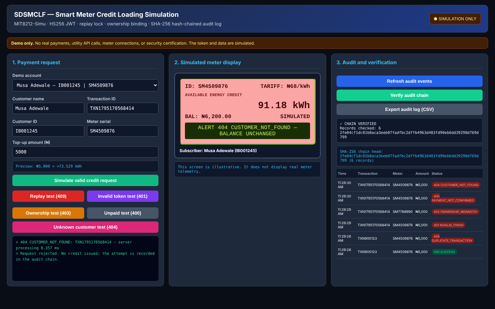
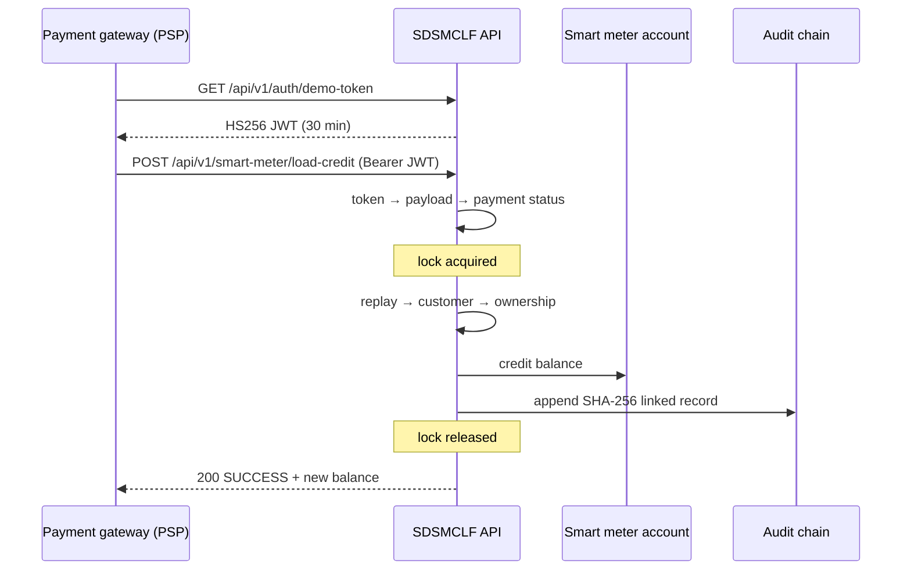
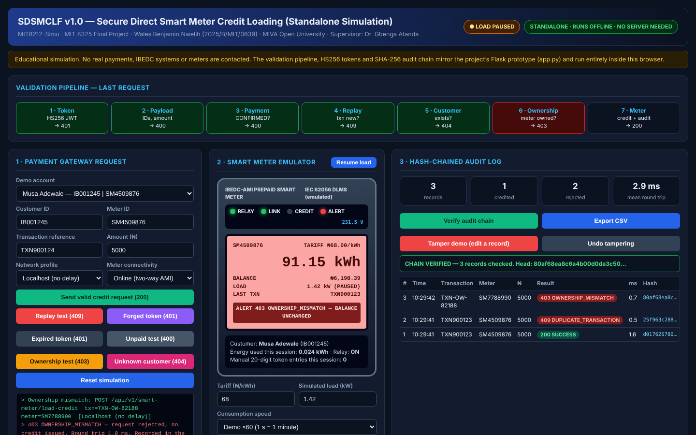
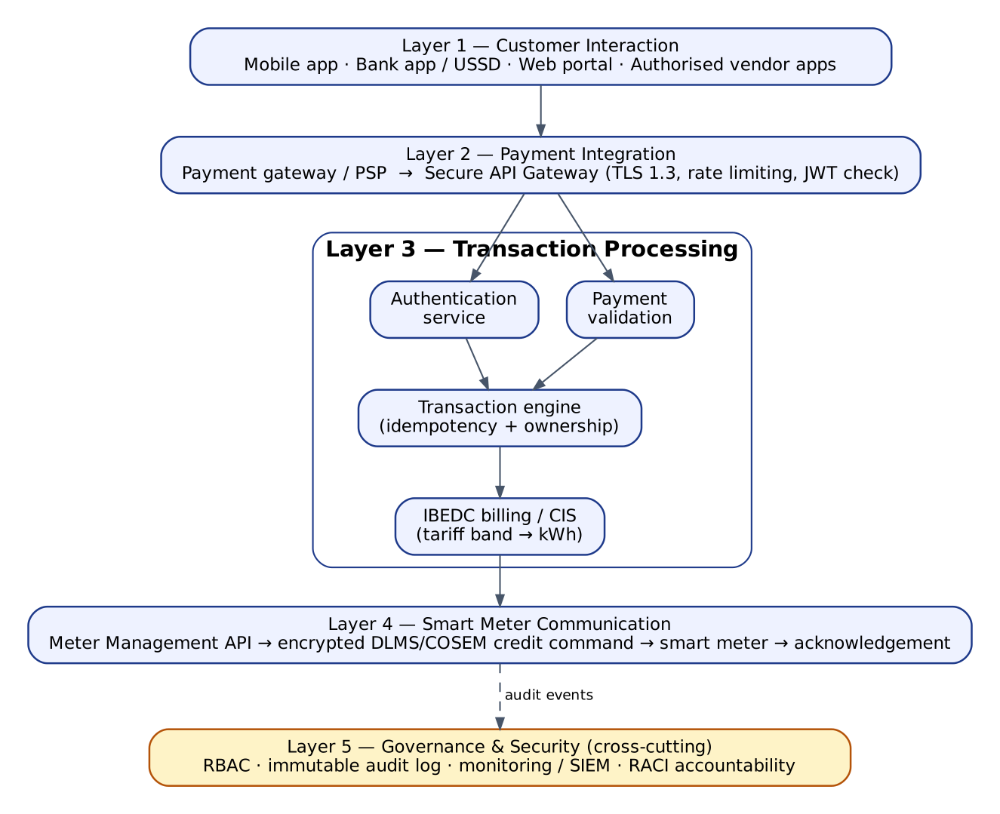
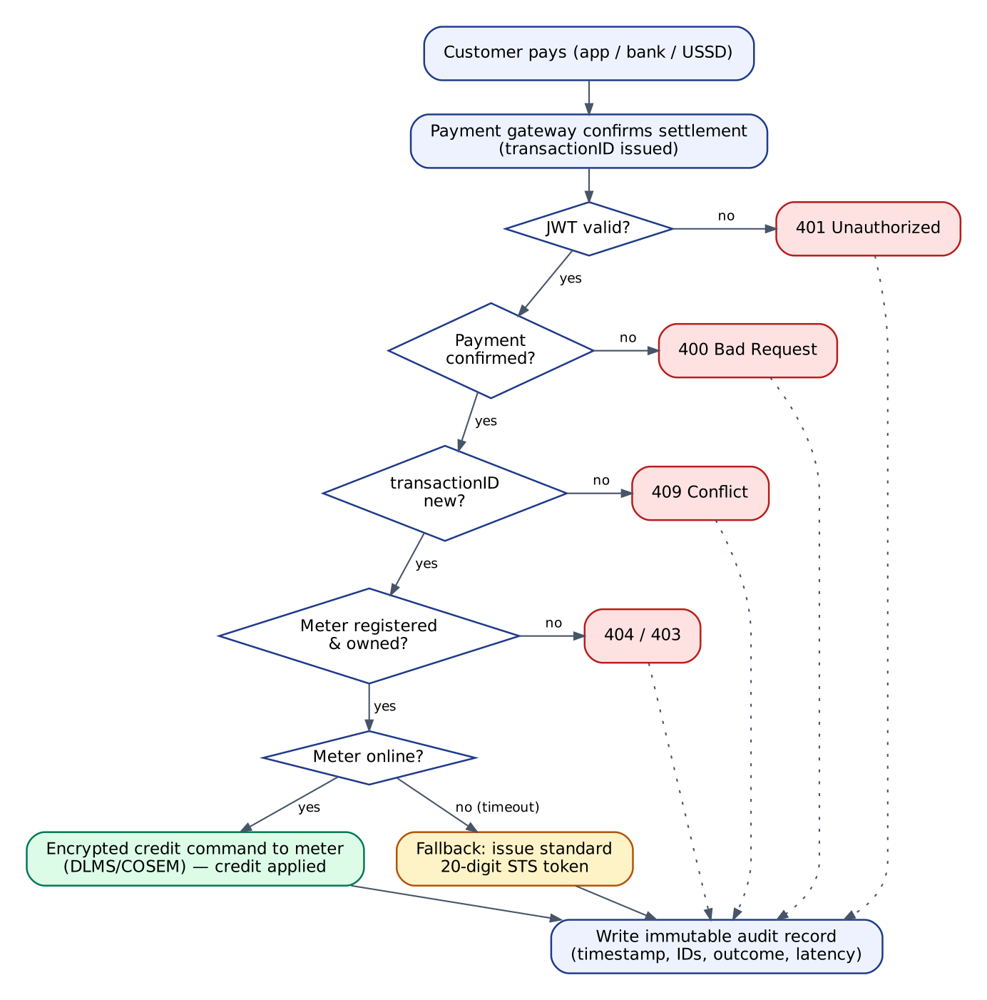

# SDSMCLF v1.0 — Secure Direct Smart Meter Credit Loading (Prototype)


[](https://github.com/BMAMPA/MIT8212-Simu/actions/workflows/tests.yml)


Proof-of-concept prototype for the MIT 8325 final project:

> **Enhancing Prepaid Electricity Billing in Nigeria through a Secure Direct Smart Meter Credit
> Loading Reference Architecture and Governance Framework (SDSMCLF v1.0): An IBEDC Case Study**
>
> Wales Benjamin Nwelih (2025/B/MIT/0839) · MIVA Open University · Supervisor: Dr. Gbenga Atanda
>
> Repository: https://github.com/BMAMPA/MIT8212-Simu

Nigerian prepaid customers pay for electricity and then type a 20-digit STS token into their meter.
Tokens get lost, mistyped or delayed, and every manual entry creates room for fraud and complaints.
SDSMCLF proposes that, once payment is confirmed, credit is **loaded directly onto the customer's
registered meter** through a secured API. Every transaction is authenticated, checked for replay and
ownership, and written to a tamper-evident audit log.

This repository is the working prototype used to evaluate that design.



---

## Contents

- [What the prototype demonstrates](#what-the-prototype-demonstrates)
- [Two ways to run it](#two-ways-to-run-it)
- [API reference](#api-reference)
- [Testing and evaluation](#testing-and-evaluation)
- [Security design](#security-design)
- [Repository structure](#repository-structure)
- [Architecture diagrams](#architecture-diagrams)
- [Limitations and future work](#limitations-and-future-work)
- [Citation and licence](#citation-and-licence)

---

## What the prototype demonstrates

Each credit request passes through seven ordered validation gates. The first gate that fails decides
the response, and **every** request, accepted or rejected, is recorded in the audit chain.

| # | Gate | Fails with |
|---|------|-----------|
| 1 | Bearer token present, HS256 signature valid, not expired | `401` |
| 2 | Transaction ID, customer ID, meter ID and amount well-formed | `400` |
| 3 | Payment gateway status is `CONFIRMED` | `400` |
| 4 | Transaction ID not already processed (replay protection) | `409` |
| 5 | Customer exists | `404` |
| 6 | Meter is registered to that customer (ownership binding) | `403` |
| 7 | Balance credited, audit record appended | `200` |

Gates 4–7 run inside a single lock, so if the same transaction arrives twice at the same moment it
is credited **exactly once**.



---

## Two ways to run it

### Option A — Standalone edition (no installation)

Double-click **`standalone/SDSMCLF_Standalone_Simulation.html`**. It opens in any current browser
(Chrome, Edge, Firefox) and runs completely offline. The same validation pipeline, HS256 tokens and
SHA-256 audit chain are re-implemented in JavaScript.



Extra features in the standalone edition:

- **Live load with Pause / Resume:** the meter consumes credit in real time. It warns below ₦500,
  the relay opens at ₦0, and a direct credit restores supply.
- **Controls:** editable tariff, load and speed, plus demo-account registration.
- **Network profiles:** localhost, 4G and 2G/GPRS latency.
- **Offline meter mode:** falls back to an STS token (`202`) when the meter cannot be reached.
- **Tamper demonstration:** edit a past audit record and watch verification fail.
- **In-browser benchmark:** an N = 100 version of the benchmark.

Timings shown in the standalone edition are in-browser measurements. The figures reported in the
project come from the Flask prototype below.

### Option B — Flask prototype

**Requirements:** Python 3.10 or newer (tested on 3.13). Library versions are pinned to safe ranges in
`requirements.txt`.

```bash
git clone https://github.com/BMAMPA/MIT8212-Simu.git
cd MIT8212-Simu
python -m venv .venv
# Windows:  .venv\Scripts\activate
# macOS / Linux:  source .venv/bin/activate
pip install -r requirements.txt
python app.py
```

Open **http://127.0.0.1:5000**. The dashboard has buttons for a valid credit and for each failure case
(replay, invalid token, unpaid, ownership mismatch, unknown customer), a simulated meter display, and
audit-chain verification with CSV export.

Demo accounts (in memory; they reset on restart):

| Customer ID | Name | Meter | Opening balance |
|---|---|---|---|
| IB001245 | Musa Adewale | SM4509876 | ₦1,200 |
| IB002390 | Amina Bello | SM7788990 | ₦3,400 |
| IB004112 | Chinedu Okafor | SM1122334 | ₦500 |

---

## API reference

| Method | Endpoint | Purpose |
|---|---|---|
| `GET` | `/api/v1/auth/demo-token` | Issue a short-lived HS256 JWT for the payment partner |
| `POST` | `/api/v1/smart-meter/load-credit` | Load credit onto a meter (alias: `/api/credit`) |
| `GET` | `/api/accounts` | List demo accounts and balances |
| `GET` | `/api/audit` | View audit records |
| `GET` | `/api/audit/verify` | Recompute and verify the full hash chain |

**Example request**

```bash
TOKEN=$(curl -s http://127.0.0.1:5000/api/v1/auth/demo-token | python -c "import sys,json;print(json.load(sys.stdin)['token'])")

curl -s -X POST http://127.0.0.1:5000/api/v1/smart-meter/load-credit \
  -H "Authorization: Bearer $TOKEN" -H "Content-Type: application/json" \
  -d '{"transaction_id":"TXN900123","customer_id":"IB001245",
       "meter_id":"SM4509876","amount":5000,"payment_status":"CONFIRMED"}'
```

**Example response (`200`)**

```json
{
  "status": "200 SUCCESS",
  "transaction_id": "TXN900123",
  "meter_id": "SM4509876",
  "balance": 6200.0,
  "processing_latency_ms": 0.31,
  "simulated": true
}
```

Sending the same request again returns `409 DUPLICATE_TRANSACTION`, and the balance does not change.

---

## Testing and evaluation

```bash
python -m pytest -q            # 14 unit tests
python app.py                  # in one terminal
python benchmark_sdsmclf.py    # in another: benchmark + concurrency + audit check
```

**Unit tests** (`tests/test_app.py`) cover:

- a valid credit, and the legacy alias route
- duplicate replay
- bad, missing and expired tokens
- unpaid transactions, invalid amounts, unknown customers and the wrong meter
- audit-chain verification and tamper detection
- 20 concurrent replays crediting only once

**Benchmark** (`benchmark_sdsmclf.py`, fixed seed 8325) sends N = 100 requests: 70 valid, plus 6 each
of the 409, 401, 400, 404 and 403 cases. Results from the reference run are in `results/`:

| Metric | Result |
|---|---|
| Correct responses | **100 / 100 (100%)** |
| Balance integrity after run | Pass |
| Server processing time (mean / p95) | 0.17 ms / 0.26 ms |
| Round-trip time on localhost (mean / p95) | 1.53 ms / 1.83 ms |
| Throughput | ≈ 645 requests/s |
| 20 simultaneous identical submissions | 1 credited, 19 rejected `409` |
| Audit chain (120 records) | Verified |

Timings depend on hardware. Re-run the benchmark to reproduce them on your own machine; the
correctness results should be identical.

---

## Security design

| Threat | Control in this prototype | Proposed production control |
|---|---|---|
| Unauthorised caller | HS256 JWT, 30-minute expiry | OAuth 2.0 with RS256/ES256 keys in an HSM, mutual TLS |
| Replayed or duplicated payment | Transaction-ID check under a lock | Idempotency key as a database PRIMARY KEY |
| Credit sent to the wrong meter | Customer–meter ownership binding | Same, backed by the utility's customer database |
| Unpaid transaction | Payment status must be `CONFIRMED` | Signed PSP callback / settlement reconciliation |
| Log tampering | SHA-256 hash chain plus `/api/audit/verify` | Write-once (WORM) audit storage |
| Rounding errors in amounts | `Decimal` parsing and bounds checks | Same, with tariff service conversion |
| Oversized payloads | 16 KB request limit | API gateway limits and rate limiting |

The signing key in `app.py` is a **demo key** and is intentionally public. Never reuse it.

---

## Repository structure

```
├── app.py                     Flask API: JWT, validation gates, replay lock, ownership, audit chain
├── benchmark_sdsmclf.py       N = 100 benchmark, concurrency test, audit verification
├── templates/index.html       Dashboard page
├── static/app.js, style.css   Dashboard behaviour and styling
├── tests/test_app.py          14 pytest unit tests
├── standalone/                Single-file offline edition (HTML + JavaScript)
├── results/                   Reference benchmark output (CSV + JSON)
├── docs/
│   ├── architecture.md        Implemented vs proposed production architecture
│   ├── diagrams/              Graphviz sources (.dot) and rendered figures (.png)
│   └── screenshots/           Dashboard and standalone screenshots
├── .github/workflows/tests.yml  Runs the test suite on every push
├── requirements.txt, pytest.ini, Procfile
├── CITATION.cff, LICENSE
```

---

## Architecture diagrams

The report diagrams were produced with [Graphviz](https://graphviz.org); the sources are in
`docs/diagrams/`.

| Five-layer reference architecture | Transaction workflow |
|---|---|
|  |  |

More detail is in [`docs/architecture.md`](docs/architecture.md) and [`docs/diagrams/`](docs/diagrams/).

---

## Limitations and future work

This is a **simulation**. It makes no real payments and does not connect to IBEDC systems or
physical meters.

Current limitations:
- Data lives in memory and resets on restart.
- The JWT key is symmetric and stored in the source code.
- Meter communication is emulated.

The next steps proposed in the project are:
- a PostgreSQL ledger with idempotency keys
- asymmetric token signing with keys held in an HSM
- mutual TLS between the PSP and the utility
- IEC 62056 DLMS/COSEM meter integration, with an STS fallback when a meter is offline
- WORM audit storage
- a controlled pilot on one IBEDC feeder, under the governance framework set out in the report

**Do not enter real customer or payment data.**

---

## Citation and licence

If you refer to this work, please cite it using [`CITATION.cff`](CITATION.cff) (GitHub shows a
"Cite this repository" button).

Released under the [MIT License](LICENSE).
